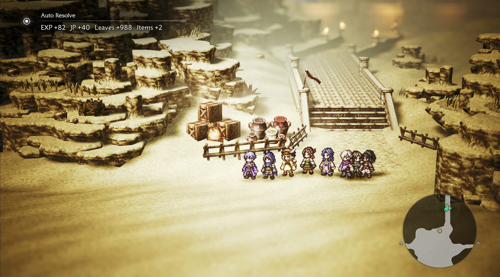

# Octopath Traveler 0 · Auto Resolve

[简体中文](README.md) · [User Guide](mod/README.md) · [Validation](VALIDATION.md)

A Windows Steam mod that skips eligible over-levelled ordinary field encounters and grants rewards through OT0's native game interfaces.

| English | 简体中文 |
| --- | --- |
|  |  |

Target: Steam AppID **3014320**, build **22012444**, with official UE4SS experimental build **3.0.1-1181-g83330635**. See [validation notes](VALIDATION.md) for tested coverage and limits.

## Features

- Only resolves ordinary encounters triggered by walking on the field. Boss, story, fixed, event and unclassified battles remain native combat.
- Requires the highest active party level to exceed the area's danger level and every selected enemy level by the configured margin (default **1**).
- Preserves native encounter selection, including rare and first-group selections.
- Grants EXP, JP, leaves, weighted item drops and verified training rewards. Native level-ups restore the character's HP/SP.
- F6 toggles auto-resolve. Chinese text languages show Chinese notifications; all other languages show English.
- Active meals and quest-specific drop cases retain normal combat.

## Installation

Install the supported UE4SS experimental loader separately. Copy `OT0AutoResolve` into `Octopath_Traveler0/Binaries/Win64/ue4ss/Mods/`, preserving the loader's other files and mods. Enable its `mods.txt` entry if your UE4SS setup requires it. The mod is enabled by default; press **F6** to toggle it.

Configure `Enabled`, `LevelMargin` (0–99) and `ShowUI` in `config.ini`. Uninstall with the game closed by removing only this mod folder and its `mods.txt` entry.

## Build and checks

See [技术规格 / Tech Spec](docs/Tech-Spec.md) for architecture and build commands. The release package does not contain UE4SS, game files, or development probes. The executable-specific hooks reject unrecognized builds before installation.

## Validation limits

The supported build has passed repeat ordinary field resolutions, reward updates, training rewards, level-up HP/SP recovery, F6, and below-threshold fallback. A positive item drop was not observed in the recorded samples, and individual boss/story/fixed battles were not each played through. See [VALIDATION.md](VALIDATION.md).

## License and notices

The OT0 mod source is not licensed for redistribution; all rights are reserved. The [UE4SS MIT license](LICENSES/UE4SS-MIT.txt) applies only to UE4SS, not this mod. This is an unofficial community mod, not affiliated with Square Enix.
